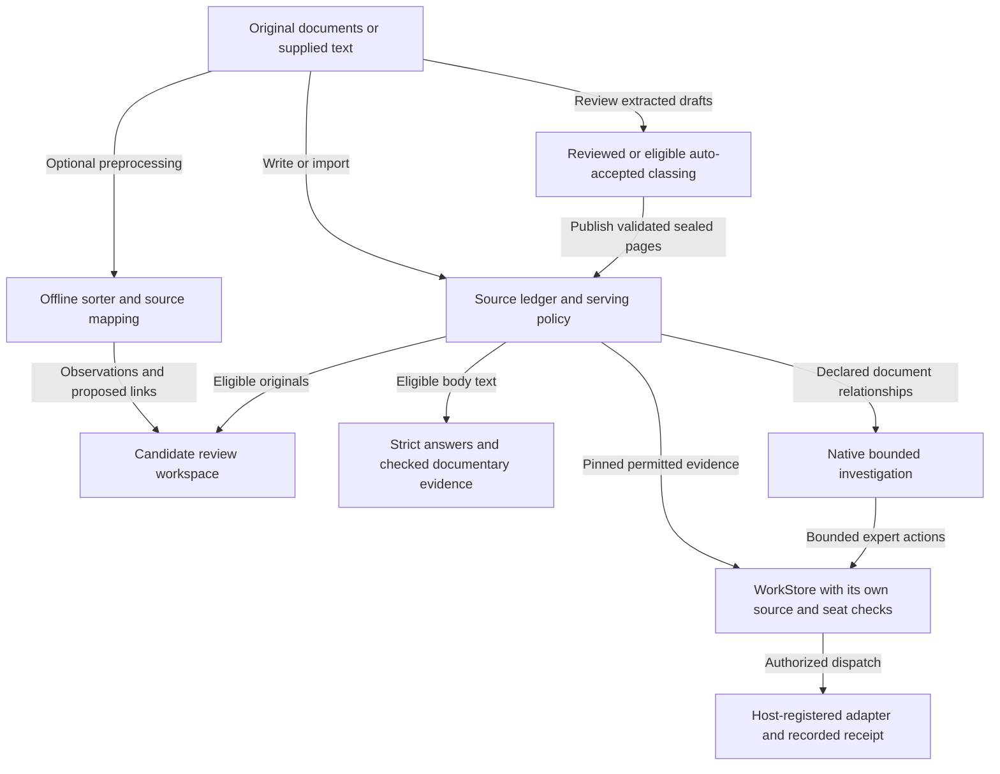
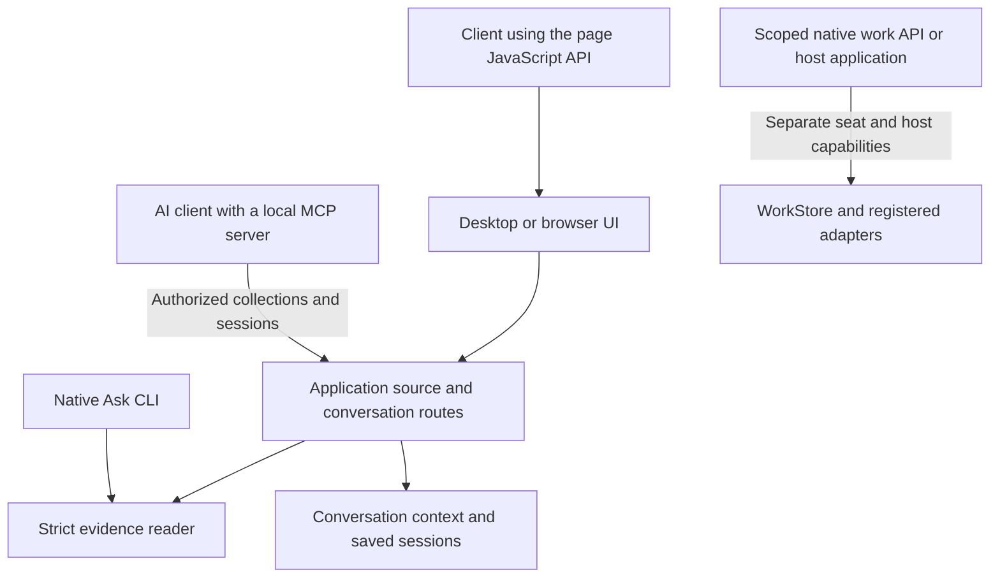

# Combined MPLPB — how the pieces connect

Last reviewed: 2026-11-22.

Combined MPLPB is a local evidence and work system. Its deterministic core checks what eligible source text supports. Other modules preserve originals, propose relationships for review, keep conversation and work history, and authorize covered actions. Optional acquisition and model assistance have their own dependencies.

The installed native ledger, sorter, strict reader, and local work coordinator can run offline on the standard Python runtime. A downloaded browser build runs its bundled engine on the device. Online source acquisition, the optional web crawler, and model downloads each require their own connection or setup. [Installation and optional dependencies](INSTALLATION.md)

**One owner returns; two stop; none refuses.** At the ownership layer, one eligible
owner can return its page, competing owners stop for ambiguity, and no eligible
owner means refusal. All eligibility rules still apply. Strict answering requires
additional support from source body wording. A selected page, a citation, a model
interpretation and a supported answer are different results.

Research status: attributable engineering contribution and technical case study,
still being tested. The combination may be distinctive; it is not proven
world-first. Independent historical semantic accuracy remains unestablished.

## How sources, answers and actions connect

Each arrow shows a handoff available through a specific entry point. A new source can enter a ledger directly or through classing. Sorting and candidate review are optional. Candidate findings stay review material, including when a workspace shows them beside eligible originals.



The workspace can call the strict reader against eligible originals. WorkStore checks its own pinned evidence, authority and action dependencies before dispatch. A passing receipt records the host's observed result. Independent historical truth and complete mediation under adversarial conditions remain open. [Candidate workspace](CANDIDATE_REVIEW_WORKSPACE.md) · [Work API](SPECIALIST_CONTINUITY_API.md#host-adapters-and-action-execution) · [Dispatch follow-up](../evaluation/comparative-tests/dispatch-enforcement/README.md)

## How people and AI clients connect



The desktop launcher uses loopback HTTP and the browser build runs the shared application code in WebAssembly. The JavaScript API works inside a running app page. Local MCP uses stdio for status, authorized collection listing, page listing and reading, strict Ask, bounded Chat, and session recovery. Its host selects the collections and delivery profile. An AI client may use its own hosted model or network service. The WorkStore CLI and optional loopback work service are separate entry points for work records and configured dispatch. [Browser runtime](BROWSER_RUNTIME.md) · [JavaScript API](../JAVASCRIPT-API.md) · [MCP tools](MCP_AGENT.md) · [Dedicated work API](SPECIALIST_CONTINUITY_API.md#dedicated-local-http-seat-api)

## Choose a workflow

| Goal | Path | What you get |
|---|---|---|
| Ask about known local pages | [Browser or terminal quickstart](../README.md#try-it-in-30-seconds) → [strict Ask](GENERAL_ANSWER_PIPELINE.md) | Source-supported answers, checked partials, conflicts or explicit refusals |
| Build a collection from a raw dump | [Sorter](PREPROCESSING_SORTER.md) → [classing](CLASSING.md) → [validated ledger generation](LEDGER_GENERATIONS.md) | A review graph if requested, reviewed drafts, sealed pages and an ingestion receipt |
| Add supplied text or capture a web source | [Collection import](EXPLORATION_COLLECTIONS.md) or configured [web acquisition](../crawler/README.md) → [collection source policy](USER_BUILT_COLLECTIONS.md) | A retained source or capture with its own provenance and serving policy |
| Update or withdraw an earlier record | [Scoped corrections](SCOPED_EVIDENCE_EXTENSIONS.md) → [supersession policy](SUPERSESSION_POLICY.md) | Pinned revisions and an explicit current or field-scoped serving view |
| Compare processed material with originals | [Sorter graph](PREPROCESSING_SORTER.md) plus eligible ledger → [candidate review workspace](CANDIDATE_REVIEW_WORKSPACE.md) | Separate processed and original statuses, source anchors and independent review and proof budgets |
| Follow documents, dates or disputed claims | [Original source inspection](ARCHIVAL_INSPECTION.md) → [investigate](HISTORICAL_EXPERT_PATH.md) or [reconstruct](HISTORICAL_RECONSTRUCTION_ENGINE.md) → optional [article dossier](DOCUMENTARY_ARTICLES.md) | Declared relationships, exact quotations, reported conflicts and open obligations |
| Continue a conversation | [Chat and Serious mode](CHAT_WORKFLOW.md) → [context](CONTEXT_INDEX.md) and [library routing](LIBRARY_ROUTING.md) | Bounded follow-ups, explicit source selection, saved context and source links |
| Carry work across instances | [Specialist work](SPECIALIST_CONTINUITY_API.md) → authorized task and claim revisions → host dispatch when configured | Visible history, failed attempts, challenges, permission checks and attempt receipts |
| Connect an agent to a collection | [MCP](MCP_AGENT.md) for an authorized native collection, or [browser middleware](AGENT_MIDDLEWARE.md) for a caller-controlled page | Tool access to the chosen interface and the engine’s original support labels |
| Reproduce or extend an experiment | [Test tools](TEST_TOOLS.md) → [frozen results and reproduction](RESULTS_AND_TESTS.md) → [B-Tests](https://github.com/mitchell-d00/B-Tests) for external comparisons | Pinned code, inputs, outcomes and the scope of each measurement |

## Package map

| Component | Implementation | Main responsibility |
|---|---|---|
| Source/page ledger | [record.py](../mplpb_combined/record.py), [ledger.py](../mplpb_combined/ledger.py) | Parse and seal native pages and preserve status, revisions, ancestry and source state |
| Ownership and policy | [reader.py](../mplpb_combined/reader.py), [provenance_gate.py](../mplpb_combined/provenance_gate.py), [delivery.py](../mplpb_combined/delivery.py), [retrieval.py](../mplpb_combined/retrieval.py) | Separate lexical selection, current eligibility, restrictions and gated page inspection |
| Strict answer layer | [pipeline.py](../mplpb_answers/pipeline.py), [support.py](../mplpb_answers/support.py), [relation_graph.py](../mplpb_answers/relation_graph.py) | Apply finite proof rules, retain conflicts and recheck current source state before acceptance |
| Documentary checker | [documentary.py](../mplpb_answers/documentary.py), [documentary_verify.py](../mplpb_answers/documentary_verify.py), [source_units.py](../mplpb_answers/source_units.py) | Propose source assertions, independently reread finite supported forms and inspect documentary units |
| Raw-material sorter | [sorter.py](../mplpb_work/sorter.py), [sorter_v2.py](../mplpb_work/sorter_v2.py) | Extract reversible observations and optional review edges, and export a validated retired snapshot |
| Classing and ledger publication | [classing.py](../mplpb_work/classing.py), [ledger_generations.py](../mplpb_work/ledger_generations.py) | Review or admit eligible clean drafts, reread inputs, stage validated pages and publish a ledger generation |
| Candidate workspace | [candidate_workspace.py](../mplpb_work/candidate_workspace.py), [sorter_suggestions.py](../mplpb_work/sorter_suggestions.py), [semantic_triage.py](../mplpb_work/semantic_triage.py) | Compare processed text with eligible originals while preserving separate result labels and budgets |
| Reversible research views | `mplpb_work/source_mapping.py`, `prose_evidence.py`, `prose_relations.py`, `event_candidates.py` | Preserve evidence anchors, candidate occurrences, conditions and unresolved relations |
| Investigation specialists | [investigation.py](../mplpb_work/investigation.py), [historical_verifier.py](../mplpb_work/historical_verifier.py) | Follow explicit in-ledger declarations through bounded, verified specialist work |
| Documentary dossiers | [article.py](../mplpb_work/article.py), [prose_evidence.py](../mplpb_work/prose_evidence.py) | Assemble read-only checked and candidate sections with source pins, conflicts and open obligations |
| Durable work and dispatch | [store.py](../mplpb_work/store.py), [source_support.py](../mplpb_work/source_support.py), [api.py](../mplpb_work/api.py), [local_artifacts.py](../mplpb_work/local_artifacts.py) | Preserve task and claim revisions, check source support and capabilities, and record host execution observations |
| Conversation/application | [ledger_ui.py](../tools/ledger_ui.py), [conversation_router.py](../tools/conversation_router.py), [index.html](../index.html) | Expose source operations and bounded conversational state through the shared App |
| Collections and session stores | [exploration_store.py](../tools/exploration_store.py), [topic_chat_sources.py](../tools/topic_chat_sources.py), [mind_session.py](../tools/mind_session.py), [context_index.py](../tools/context_index.py) | Keep named collections, capture versions, saved turns and attributed context at their declared storage boundaries |
| Browser runtime | [bridge.py](../browser/bridge.py), [worker.js](../browser/worker.js), [build_browser_runtime.py](../tools/build_browser_runtime.py) | Run the Python engine in browser WebAssembly using per-origin storage |
| JavaScript and agent bridge | `JAVASCRIPT-API.md`, `tools/mplpb_agent_bridge.mjs`, `.well-known/mplpb.json` | Describe page-local transport, discovery and public snapshot limits |
| Native MCP | [mplpb_mcp.py](../tools/mplpb_mcp.py) | Expose authorized collections through local stdio tools with a host-fixed delivery profile |
| Acquisition | collection/capture tools and `crawler/worker.mjs` | Retain supplied/captured source material under explicit acquisition rules |
| Optional model paths | `mplpb_answers/local_reader.py`, browser helper/assets | Propose or discuss material without replacing deterministic proof or source policy |
| Bundled reference material | `resources/`, `reference_corpus/` | Keep licensed references and separately gated machine-derived lab data |
| Evidence and distribution | `evaluation/`, `tests/`, build/reproduction tools, `.github/workflows/` | Retain measurements, failed cases, package pins and release receipts |
| Fresh evaluation batches | `test_tools/generate_open_data_seeds.py`, `primary_book_test.py` | Generate seeded collection plans and book excerpt tests. Keep the answer key with the custodian. |

Paths above are source responsibilities, not interchangeable public interfaces.
The wheel contains the three Python packages; the full checkout includes the App,
source tools, resources, MCP launcher and retained evidence. The browser build has
its own selected bundle. Presence in the repository does not mean every component
is exposed through every delivery mode.

## Sort and import

The sorter accepts directories of UTF-8 text and Markdown. It leaves originals
unchanged and records source IDs/hashes, statement text, byte and character spans,
keys, dates, headers, references, action-word candidates and repeated phrase keys.
It works without a model, network connection or manually inserted answer fields.
Its recognizers are finite and incomplete.

| Mode | Nodes and provisional statuses | Edges |
|---|---|---|
| not-compared | Same source-anchored observations in both modes | Containment and textual co-occurrence only |
| compare | Identical nodes, spans, hashes and provisional statuses | Same observation prefix plus review proposals, candidate clusters and possible correction windows |

Compare never merges occurrences into a historical event. Shared subject wording
alone cannot establish identity. Changed bodies under shared identifiers are flagged.
Missing or ambiguous intermediate records stop documentary hops. Correction windows
remain literal, unapplied proposals. Every assessment remains non-authoritative.
The envelope also records mode, digest and any comparison-budget limitations.

```bash
python -m mplpb_work.sorter sort RAW_DIRECTORY \
  --mode compare --output NEW_GRAPH.json
python -m mplpb_work.sorter verify NEW_GRAPH.json --sources RAW_DIRECTORY
python -m mplpb_work.sorter peruse NEW_GRAPH.json --sources RAW_DIRECTORY
python -m mplpb_work.sorter export-retired NEW_GRAPH.json \
  --sources RAW_DIRECTORY --ledger NEW_SNAPSHOT_DIRECTORY
```

Output paths must be new and outside the raw input tree. `verify` reloads and
replays source fidelity; it does not verify semantic correctness. Budgets and
exclusions are explicit. Oversized statements or missing records do not justify
inventing a completed relation.

The snapshot is a native sealed page containing the candidate graph. Export
validates the staging ledger, checks exact graph recovery and retires the page
before publishing it. Native `validate --strict` and `show` accept it for inspection;
`gate` and `ask` withhold it under lab/internal/external. It is **not** an eligible
source of historical facts. Do not activate the graph as an answer page.

To ask about originals, use the existing collection import/source-management paths
with the originals' actual ownership, provenance and restrictions. Supplied text
and a URL label are not proof that a site was downloaded or that authorship was
authenticated. Preserve original captures and their versions. PDF extraction/OCR
is outside the sorter. [Complete sorter contract](PREPROCESSING_SORTER.md).

## Ledger and eligibility

A ledger is a folder of native pages plus its retained history. Pages declare
identity, scope, status, hash, origin/depth and optional ancestry/delivery fields.
The existing writer seals these fields/content; revisions write successors,
withdrawal retains predecessors, and derivatives pin their bases.

The gate checks current source integrity, lineage and serving policy. Retired,
corrupt, stale, restricted or otherwise ineligible pages cannot supply accepted
answer evidence. Current eligibility is rechecked rather than permanently cached.
A title or filename can help locate a source but cannot supply a body assertion.
A pointer is navigation, not evidence or permission to fetch another collection.

Profiles are policy views, not evidence-strength ratings. Lab, internal and external
have different depth/prose settings; explicit restrictions and exclusions remain
binding. Changing a profile is a host/operator decision, not a model permission.
A page becoming visible does not make its content true.

Native management uses the existing commands:

```text
python -m mplpb_answers validate LEDGER
python -m mplpb_answers show LEDGER RECORD_ID
python -m mplpb_answers history LEDGER RECORD_ID
python -m mplpb_answers write --help
python -m mplpb_answers revise --help
python -m mplpb_answers withdraw --help
```

See [provenance](PROVENANCE_GATE.md), [delivery](DELIVERY_AND_CLARIFICATION.md),
[supersession](SUPERSESSION_POLICY.md) and [scoped corrections](SCOPED_EVIDENCE_EXTENSIONS.md).

## Answers and inspection

| Result route | What can be relied on | What must not be inferred |
|---|---|---|
| Strict supported answer | Eligible source body satisfies an existing deterministic proof rule for the question | Authenticated testimony or independently established historical truth |
| Checked partial answer | Specified portions have checked source support; unresolved parts remain visible | That every obligation or the complete question was answered |
| Candidate inspection | Material was selected for inspection | That lexical ownership, a graph edge or a citation proves the proposition |
| Gated page retrieval | The selected owner passes serving/provenance checks | An answer to the question merely from returning the page |
| Source bundle | Eligible matches remain separate | Agreement, event identity or a chain connecting them |
| Model-assisted interpretation | A labeled proposal passed the stated structural/citation checks | Independent semantic verification or strict support from model confidence |

The installed `mplpb-combined ask` and `python -m mplpb_answers ask` use the strict
answer pipeline by default. `candidates` exposes lexical inspection. The legacy
`python -m mplpb_combined ask` keeps its older candidate interface; do not present
that output as the modern strict answer contract.

The strict-first path can still prove a source assertion when assisted mode is
requested; it labels that accepted result as strict. The model-only fallback
remains unsupported. The outer API's `ok:true` and a tool's successful execution
are transport outcomes. Inspect the decision, `answer_contract`, support flags,
qualifications, citations and unresolved evidence.

Refusals distinguish unsupported question grammar, missing eligible evidence,
conflicts, unresolved identity, insufficient context and exhausted budgets. Known
contradictions must not disappear because another source ranks higher. Source or
policy changes discard stale accepted material. [Reader contract](GENERAL_ANSWER_PIPELINE.md)
· [Retrieval interfaces](PAGE_RETRIEVAL.md) · [Diagnostics](CLOSED_LEDGER_BOUNDARIES.md).

## Documentary research

`reconstruct` inspects complete source units/layer hints, question obligations,
checked documentary statements, exact wording differences and reversible candidate
relations. `investigate` follows explicit declared document relationships within
the authorized ledger through bounded specialist operations. This is distinct from
web crawling and distinct from raw-text sorting.

```text
python -m mplpb_answers reconstruct LEDGER "Compare the wording in the accounts."
python -m mplpb_answers investigate LEDGER "Trace declared relations" --source DOCUMENT-0001
```

A report can retain an existing strict answer and individually checked portions.
The candidate graph does not grant support. A letter's stated instruction does
not establish receipt, execution or delivery. A printed date is not automatically
an event date. Matching names do not resolve identity; chronological order does
not establish cause. Partial corrections preserve prior statements and cannot
rewrite ledger history during a read-only investigation.

Original-byte mapping is available where the retained import receipts/captures
provide it. Canonical offsets alone are not an independently checked original-byte
mapping. The finite kernel re-reads eligible source material; quotation fidelity,
source-attributed support and historical truth remain different states.

[Reconstruction](HISTORICAL_RECONSTRUCTION_ENGINE.md) · [Documentary checks](DOCUMENTARY_ASSERTIONS.md)
· [Expert path](HISTORICAL_EXPERT_PATH.md) · [Mapping](SOURCE_MAPPING_REPAIR.md)
· [Truth/review rules](HISTORICAL_TRUTH_RULES.md) · [Solo workflow](SOLO_RESEARCH_WORKFLOW.md).

## Conversation and resources

The conversational App uses explicit context, request and response-construction
rules. It can discuss loaded sources, ask for clarification, retain selected steps,
look up dictionary senses and route through a declared library hierarchy. Ordinary
local chat does not require a language model.

Chat, Serious and off-the-record free chat retain different scope/storage behavior.
User declarations, corrections, hypothetical premises, calculations, seed notes,
dictionary results and ledger evidence retain their own authority labels. A saved
conversation or research note does not become a ratified source page.

The context index preserves explicit personal details, selected references and
bounded correction/follow-up state. The library routes to declared shelves/books;
it does not combine unrelated ledgers into an answer. Procedure inspection follows
source-authored steps and qualifiers. Reading the next instruction does not prove
that a previous instruction was executed or its condition satisfied.

The bundled resource pack contains Open English WordNet 2025, CMU Link Grammar
reference material and selected pinned Simple English Wikipedia captures. The
Link Grammar data does not mean a general parser is enabled, and the encyclopedia
selection is not a complete or current web corpus. The separate reference-corpus
preview is machine-derived, unratified and lab-only; it is not the default hosted
app's authoritative knowledge base.

[Conversation](CHAT_WORKFLOW.md) · [Context](CONTEXT_INDEX.md) · [Library](LIBRARY_ROUTING.md)
· [Procedures](PROCEDURAL_CONSTRAINTS.md) · [Resources](../resources/README.md)
· [Lab corpus](../reference_corpus/README.md).

## Work and receipts

The native coordinator uses SQLite from the standard library. It retains tasks,
evidence, working claims, decisions, actions, reviews, attempts and revisions.
A host issues scoped, expiring seat capabilities; explicit visibility, revision
pins, fencing and current source checks constrain work and handoffs.

A successor instance can recover the authorized work view without claiming it is
the same model/runtime. Submitted success, saved completion wording or specialist
agreement cannot create a passing host execution receipt. Host dispatch and
reconciliation retain actual observed attempts; their guarantees are bounded by
the declared host/process/filesystem trust assumptions.

STORE, DISPATCH, DELIVERY, READ, ACK and COMPLETION are distinct receipt kinds.
Host observations do not establish human reading, physical delivery or outside-world
execution merely because they are stored. Optional local artifact checks establish
byte equality under the trusted native host, not historical truth or durable
storage. Work records cannot bypass source eligibility or become strict answer
facts by persistence alone.

Use `python -m mplpb_work --help`, installed `mplpb-work`, or the existing
`mplpb-combined work` forwarding route. Keep host credentials private; do not paste
them into model context or source pages.
[Coordinator/API](SPECIALIST_CONTINUITY_API.md) · [Continuity model](SPECIALIST_CONTINUITY.md).

## Connections and acquisition

| Route | Where it runs | Important boundary |
|---|---|---|
| JavaScript `window.MPLPB` | Inside the opened desktop/standalone app page | Not an arbitrary remote HTTP query endpoint |
| Agent/browser bridge | A caller-controlled running browser | Preserves reader decisions and the selected browser's storage boundary |
| Local MCP stdio | Full native checkout, host-authorized roots/profile | Seven reader/chat/session tools; no source import, revision, withdrawal or ratification tools |
| Wikipedia/source collection tools | Existing App source-management flow | Explicit or enabled acquisition uses network; imported/captured evidence still passes source checks |
| Hosted general-web crawler | Separately configured Worker | Not deployed by Pages; accounts, authentication, network policy and quotas are separate |
| Explicit crawler seeds | Same authenticated crawler route/native Node function | HTML/text captures with optional raw-byte pins; no PDF/OCR or automatic truth admission |

`importSource({corpus,title,url,text})` retains caller-supplied text; it does not
fetch the URL. The crawler distinguishes direct source sets from provider-backed
search. Direct seeds do not need a search key, but still need the endpoint's
access policy. Provider snippets are navigation, not imported factual evidence.
Robots, redirects, source types, byte/time/count limits and failures remain visible.

The MCP host chooses exact collections and a fixed delivery profile. Its tools
include status, collections, page listing/reading, strict Ask, bounded Chat and
session recovery. Chat may save context, but cannot manufacture source facts.
Browser IndexedDB is not exposed through native filesystem paths or a public URL.
Public discovery and the build-time external snapshot reveal only their declared
public surface.

[JavaScript API](../JAVASCRIPT-API.md) · [MCP](MCP_AGENT.md) · [Agent middleware](AGENT_MIDDLEWARE.md)
· [Collections](EXPLORATION_COLLECTIONS.md) · [Crawler setup](../crawler/README.md).

## Optional models

Core ledger, strict answering, sorter and deterministic conversation work without
a model. Two optional paths have different requirements:

- Native assisted reading uses an explicitly installed local reader/model through the existing loopback transport. No weights are automatically downloaded. Its model-only conclusions remain unsupported.
- The optional public browser helper can load supported pretrained models on compatible WebGPU devices. Model downloads, sidecar assets, licenses, browser/device memory and generation-time failures are separate from core availability. Source drafts require review before saving.

The helper cannot silently ratify, delete or rewrite sources. A successful model
load is not proof of successful generation, useful reasoning or truth. The single
HTML browser ZIP does not include model weights and all optional site sidecars.
A separately hosted inference service is not bundled or implicitly configured.
[Native reader](GENERAL_ANSWER_PIPELINE.md) · [Browser helper](FREE_PUBLIC_HELPER.md) · [Constrained local narrator](LOCAL_NARRATOR.md)
· [Asset notices](../assets/ai/README.md).

## Storage and recovery

| Store/artifact | Retained material | Recovery limit |
|---|---|---|
| Native page ledger | Pages, seals and ledger history | Preserve the actual ledger directory and private originals/receipts, not just an answer |
| Native application workspace | Named collections, capture versions and saved sessions | Protect the workspace and its source dependencies; code checkout alone is not a user-data backup |
| Browser IndexedDB | Sources/sessions for that browser origin | Clearing/eviction/origin changes can lose data; native MCP does not read it |
| Transcript export | Conversation and retained pins | Not a complete source-ledger or browser-store backup |
| Specialist work database | Capability-filtered work history and host observations | Credentials and referenced artifacts/sources need their own protected preservation |
| Sorter graph/snapshot | Extracted statements, anchors, proposals and optional prior snapshot | Keep raw originals; fidelity checks require their bytes and implementation pins |
| Source release ZIP | Tracked repository at a commit, including docs/evidence | Excludes Git history and private/untracked local state |

Clearing named collections can archive native collection material rather than
purging every retained source byte. Reopening the same browser origin is not a
disaster-recovery guarantee. Permission, backup, export and migration needs should
be assessed against the actual deployment and storage mode.
[Collections](USER_BUILT_COLLECTIONS.md) · [Capture compatibility](BROWSER_CAPTURE_COMPATIBILITY.md)
· [Rollback](ROLLBACK.md) · [Threat model](PRODUCTION_THREAT_MODEL.md).

## Delivery and packaging

| Distribution | Includes | Does not imply |
|---|---|---|
| `mplpb-monster.zip` | Committed full source, launchers, tools, resources, examples, tests, docs and retained evidence | Saved user data or a Git history backup |
| `mplpb-monster-browser.zip` | Prebuilt standalone `MPLPB_Browser.html` and instructions | All optional hosted sidecars, model weights, remote MCP or a server |
| `combined_mplpb-*.whl` | `mplpb_combined`, `mplpb_answers`, `mplpb_work`; installed answer/library/work/evaluation CLIs and sorter module | The complete App, source-checkout tools, reference files or example corpora |
| Hosted Pages site | Generated WebAssembly app and configured public sidecars | Shared access to visitors' private browser data or a deployed general-web crawler |

The declared package version is 2.1.0rc1; legacy core 1.0.0 and JavaScript API 1.0.0
are separately versioned. The paper version and content-derived runtime build ID
are different identifiers. Source packaging uses committed HEAD and a current
handoff; test/packaging/deployment receipts must name the artifact they describe.

The five preserved implementations in `parts/` remain separately runnable with
their own contracts and notices. Their network signatures, image attestation or
other independent features are not automatically enabled in the combined reader.
Original papers, resource documentation and frozen evaluation materials retain
their own dates and bytes.
[Install](INSTALLATION.md) · [Repository map](../CONTENTS) · [Preserved parts](../parts/README.md).

## Evidence and limits

Retained controls support claims about software behavior at their pinned revisions.
They do not establish independent historical accuracy or production readiness.
The sorter fixture family checks identical nodes, original spans, stopped links,
wrong-body/corruption rejection and native all-profile withholding. More candidates
or passing software tests are not historical answer-completion gains.

The separate 22-question development replay records 2 complete source-supported
answers and 1 checked partial at its named runtime. Independent semantic validation
on 200 unseen historical questions has not been performed. Human-reviewed accuracy,
relationship precision/recall and proposed target attainment cannot be filled in
with zeros or inferred from the test count.

A coherent false source can remain coherent inside the ledger. A source assertion
about a cause does not independently establish that cause. Unsupported actor/event
identity, conditions, contradictions, incomplete/OCR context and exhausted budgets
can all require refusal or candidate-level inspection. Shared-service security,
physical-device model behavior, backup recovery and semantic usefulness have
separate remaining evidence needs.
[Current evidence](CURRENT_STATUS.md) · [Result/test index](RESULTS_AND_TESTS.md)
· [Production scope](PRODUCTION_READINESS.md) · [Review rules](HISTORICAL_TRUTH_RULES.md).

## Documentation and preserved history

### Companion projects and repository material

| Project or area | How it connects | Where to start |
|---|---|---|
| B-Tests | Separate comparative testbench. Its native jobs check out pinned MPLPB revisions. Its instruction-level and native experiments keep their own inputs, results and scope. | [B-Tests protocol](https://github.com/mitchell-d00/B-Tests/blob/main/PROTOCOL.md) · [Comparative evidence in MPLPB](RESULTS_AND_TESTS.md#executable-gates-comparative-tests) |
| Earlier MPLPB implementations | Five separately runnable implementations under `parts/`. Local Mirror and Smart Local cover earlier local reading interfaces. Swarm covers its own leases and fencing, Networked its own node/signature flow, and Image its own image-page evidence and attestation. | [Preserved parts](../parts/README.md) |
| Give It Back: The RPG | Source of the adapted browser UI layout. The retained notice documents the credited contribution. | [UI attribution](BROWSER_UI.md) |
| Specialist continuity research | The Instance Is Not the Model informs instance lineage. The Seat Is Not a Costume informs scoped seat contracts. The Watcher Is Not a Thing informs review records and stopping budgets. The continuity guide links the pinned sources and explains their design applications. | [Research connections](SPECIALIST_CONTINUITY.md) |
| Examples, pinned resources and lab data | `examples/` supplies demonstration ledgers. `resources/` holds licensed local reference data. `reference_corpus/` is a separately gated, machine-derived lab preview. | [Repository inventory](../CONTENTS) · [Resource manifest](../resources/README.md) · [Lab corpus](../reference_corpus/README.md) |
| Research preparation and historical material | `training/owner-work/` records candidate source preparation. `papers/`, `killtest/` and `evaluation/` preserve source material, earlier probes and measured runs. | [Owner-authorized preparation](../training/owner-work/README.md) · [Papers](../papers/README.md) · [Results and tests](RESULTS_AND_TESTS.md) |
| Build and release | Python wheel and source ZIP package the native runtime. The browser builder pins the WebAssembly core and selects its bundle. CI tracks handoff freshness and checks the source archive, browser candidate and deployed Pages site. | [Installation and distributions](INSTALLATION.md) · [ZIP-first checks](ZIP_FIRST_RELEASE_TESTING.md) · [Repository workflows](../.github/workflows/) |

Start here for package composition, the [README](../README.md) for an overview,
and the [documentation index](README.md) for every current guide and specialist
contract. Operational guides can contain dated measurements; their review markers
do not rerun those experiments. [Past documentation](../PAST_DOCUMENTATION.md),
[original papers](../papers/README.md), [earlier implementations](../parts/README.md)
and dated reports remain distinct from current usage instructions.

The sorter technical report by Mitchell D. McPhetridge is available in
[Markdown](research/dual-mode-sorter/dual-mode-sorter.md),
[text](research/dual-mode-sorter/dual-mode-sorter.txt) and
[PDF](research/dual-mode-sorter/dual-mode-sorter.pdf). This package-guide update
does not revise that paper or its measurement claims.

The optional [candidate review workspace](CANDIDATE_REVIEW_WORKSPACE.md) is a native/CLI module in `mplpb_work/candidate_workspace.py`. Its reversible byte projection lives in the installed `mplpb_answers/source_projection.py`; it does not require checkout-only research tools. Processed exploration retains separate evidence labels and budgets and does not replace the application’s strict reader.
