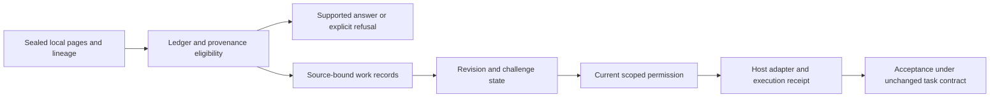

# MPLPB originality and priority reassessment

Last reviewed: 2026-11-10.

Research author: **Mitchell D. McPhetridge**. Prepared through a Codex-assisted
source and prior-art audit. Status: **attributable engineering contribution and
technical case study; still being tested**.

**For MPLPB, the particular combination may be distinctive, but it is unproven
as world-first.** No new universal law or confirmed world-first architecture is
claimed. This source audit and its software regressions are not independent
replication or proof of general effectiveness. See the [release note](RELEASE_NOTE.md)
for the included completion-integrity fix and continuing experimental work.
Baseline: PR #38 commit `4fd0203e26d90b267480c3c06a5ef4b06444641e`.
This reassessment changes documentation only. The earlier repair, tests, cases,
results, papers and archived implementations remain unchanged.

## Finding: qualify the earlier classification

**PR #38's classification is defensible for the general logical principle, but
too broad if applied to MPLPB's entire architecture, mechanisms or implementation.**
The report already acknowledged a new synthesis and local correction, but its
single headline did not express that distinction adequately. This reassessment
qualifies that headline; it does not reverse the sound software findings or
replace one blanket verdict with a positive novelty claim.

Finding a mechanism in Mitchell's earlier work supports earlier **internal
attribution**. It does not, by itself, demonstrate external prior art or negate
originality. Conversely, an attributable local formulation does not establish
first invention, independent development, first public disclosure or scientific
effectiveness. Those claims require different evidence.

The inspected source supports specific functional differences and an attributable
integration. The bounded comparison did not establish worldwide priority for that
integration. It also found close earlier combinations, including agent ledgers,
temporal provenance memory, and authorized checkpoint workflows. These prevent
claiming that the broad combination of memory, provenance and verification is new.

## Five separate judgments

| Novelty dimension | Finding | Status and limits |
| --- | --- | --- |
| Logical | A result establishes only the postconditions warranted by its assumptions and contract. Hoare's proof obligations and Meyer's contracts already supply this distinction. | General logical novelty **contradicted**. PR #38's qualification for guarantees by construction remains valid. |
| Architectural | MPLPB integrates page eligibility/refusal with typed revisable work, present authority and receipt acceptance. The bridge is executable, rather than merely shared terminology. | Exact synthesis **plausibly distinctive; priority unresolved**. Closely related combinations predate the October coordinator. No exhaustive equivalence search or new architecture theorem was performed. |
| Mechanism | Some broad primitives have direct predecessors; the exact scope, serving and work-state policies differ from selected implementations. | **Mixed**, as the [12-row matrix](MATRIX.md) specifies. No aggregate novelty verdict substitutes for those rows. |
| Implementation | The repository contains identifiable choices in data structures, state transitions, failure handling and integration. | **Supported implementation differences and attribution; global implementation novelty not established.** Different code or a different field name alone is not an invention. |
| Empirical | The particular completion-integrity defect and repair are traceable local observations. Earlier systems already document incomplete verification and use independent acceptance tests. | **Supported new local failure trace**, not a newly established general phenomenon, evaluation method or independently replicated cross-domain benefit. |

Here, “supported” for a local observation does not mean worldwide novelty is
supported. Each matrix row states exactly which claim is under consideration.

## What the architecture actually connects

The important connection is `WorkStore._source`: it calls the existing provenance
gate and ledger, checks the pinned page and body quotation, derives source roots,
and carries delivery constraints into work records. `_effective` propagates stale
revisions/challenges; `_permission` checks the current seat grant and prerequisites;
`execute` records host-controlled outcomes; completion checks receipts and the task
contract. These are inspectable implementation relationships.

This is a connected family of contracts, not a new global promotion framework or
one proved universal engine. Release verification checks the packaged software
separately. The native specialist coordinator is not a browser-hosted autonomous
team. The source record's declared author/origin and matching seals do not
authenticate authorship or establish factual truth.

The test `test_source_change_invalidates_claim_decision_action_and_completed_task`
exercises the integration directly. Its existence is software evidence under its
assertions, not proof that no earlier architecture integrated comparable checks.

## Closest comparisons and actual differences

The [code inventory](external-code.json) pins **16 files from 10 external
repositories**, including exact commit/blob identities and SHA-256. Targeted
functions and structures were inspected; no external implementation was executed
and no whole-project absence claim is warranted. Most snapshots precede 2025;
Graphiti's pinned snapshot precedes 2026. Recent literature was also searched through
the audit date, so the search was not restricted to those older snapshots.

* [Nanopublications / Trusty URIs, 2014](https://2014.eswc-conferences.org/sites/default/files/papers/paper_106.pdf)
  already combine assertions, provenance and verifiable reference trees. The
  inspected Java implementation separately checks structural, hash and signature
  properties. MPLPB's current-page serving and scope/refusal policy differ; its
  unsigned seals lack some guarantees that nanopublication signatures provide.
* [FEVER, 2018](https://aclanthology.org/N18-1074/) and
  [ALCE, 2023](https://aclanthology.org/2023.emnlp-main.398/) already separate
  retrieved/cited evidence from the claim or citation-support judgment. MPLPB's
  finite deterministic grammar and source-eligibility integration are particular
  implementation choices, not the first general retrieval/support distinction.
* [Magentic-One, 2024](https://www.microsoft.com/en-us/research/wp-content/uploads/2024/11/MagenticOne.pdf)
  is a close architectural comparison: it maintains task/progress ledgers and
  recovers from stalled agent work. In the inspected AutoGen snapshot, completion
  follows a model-produced ledger decision; MPLPB requires host-created receipts
  and explicit current contracts. The paper also records failures from inadequate
  verification before completion. Neither ledgers nor that broad failure class
  originate with PR #38.
* [Zep / Graphiti v1, January 20, 2025](https://arxiv.org/html/2501.13956v1)
  combines source episodes, historical relationships and temporal invalidation.
  Its inspected code stores episode links and validity timestamps and uses model
  calls in edge resolution. MPLPB's explicit page/revision/grant checks implement
  a different authority policy. Persistent provenance-sensitive agent memory is
  nevertheless an earlier combination, not a novelty established here.
* [Cravero's experience report v1, posted September 29, 2026](https://www.preprints.org/manuscript/202609.2499/v1)
  is an especially close workflow predecessor: it describes protected baselines,
  bounded authorized interventions, persistent evidence and separate verification.
  Its Appendix A.1 presents an operational checkpoint contract. This predates the
  located October 31 MPLPB coordinator. It is an experience report, not inspected
  source proving an identical token/fence/receipt engine. Its later
  [Poblete–Cravero–Diaz paper, November 5](https://doi.org/10.3390/electronics15215135)
  explicitly limits claims about complete automated provenance enforcement.
  November-only wording is not backdated to the September version.
* [Doyle's reason-maintenance work, 1979](https://dspace.mit.edu/entities/publication/5377b306-4ecc-4687-b1f5-78cbb4a0543a),
  [PROV-O, April 30, 2013](https://www.w3.org/TR/2013/REC-prov-o-20130430/),
  [Macaroons, 2014](https://research.google/pubs/macaroons-cookies-with-contextual-caveats-for-decentralized-authorization-in-the-cloud/),
  and the pinned Temporal/LangGraph code supply older dependency, provenance,
  scoped-authority and recovery mechanisms. They are relevant antecedents, not
  evidence that their complete architectures are identical to MPLPB.
* [in-toto, USENIX Security 2019](https://ssl.engineering.nyu.edu/papers/torres-toto-usenix19.pdf)
  verifies authorized signed evidence and artifact rules against a layout.
  [SWE-bench, first submitted October 10, 2023](https://arxiv.org/abs/2310.06770v1)
  evaluates proposed patches against fixed task requirements. MPLPB's receipt
  implementation differs, but acceptance under specified requirements and
  supply-chain evidence checking are established mechanisms.

These sources are comparisons, not asserted sources of Mitchell's discovery or
proof that he copied an implementation. Functional overlap does not establish
influence; functional differences do not establish independent invention.

## Intellectual development and date discipline

The [dated timeline](TIMELINE.md), [39-witness source inventory](mplpb-sources.json)
and [five archive records](archive-witnesses.json) preserve different kinds of
chronological evidence. Important distinctions are:

1. Local Web v4 declares **August 5**, Smart Local declares **August 12**, and the
   Continuation manuscript declares **September 2026**. These locate attributed
   precursor formulations; they are not independently archived public dates.
2. The earliest located Git records include the October 7 README, root FIXLOG,
   current and archived readers, and Combined paper. The paper exists at
   `docs/Combined_MPLPB.md` before its October 8 `papers/` copy. Following old paths
   changes the retention chronology; a later inventory path is not invention date.
3. Source-bundle provenance, strict supported answering, candidate retrieval and
   specialist enforcement were added or repaired at distinct October revisions.
   The complete coordinator cannot be backdated to the August substrate paper.
4. Independently hosted PhilArchive history records date general MPLPB material
   to **January 2**, Clarity and stateless continuity titles to **July 7**, the
   domain-precedence paper to **July 10**, and Continuation to **September 22**.
   This strengthens earlier attribution beyond October Git uploads. Version-file
   downloads returned HTTP 403, so the current repository copies were not bound
   byte-for-byte to those archived versions. An archive record is not a test run.
5. GitHub timestamps for PR #6 and PR #20 corroborate October development activity
   separately from Git author dates. Repository creation is host metadata, not proof
   that every file was public then. The September 22 Continuation archive record
   precedes Cravero's September 29 report; neither ordering establishes that their
   mechanisms are identical or dates the October native coordinator to September.
6. PR #38 introduced the working synthesis/specification and the narrow completion
   repair on November 10. It recognized most underlying mechanisms already present.
   Retrospective references to B.A.S.I.C. AI in 2025 or July author-run trials do
   not independently date the later executable integration.

Thus, earlier internal occurrence supports attribution and development chronology.
External priority requires ordering the **same sufficiently specified mechanism**
against external evidence of comparable strength. A month-only manuscript date,
a later copy, an account name or a Git timestamp alone cannot settle that question.

## Attribution without overstating authorship

The original headers and archive records attribute the MPLPB formulations to
Mitchell D. McPhetridge. Scope precedence, portable self-describing artifacts,
revisability and their later operational policies have a documented MPLPB lineage.
That is an affirmative attribution finding; earlier occurrence within that lineage
does not count as an outside predecessor that defeats the author's originality.

Repository implementation should be credited at its documented level. This audit
and PR #38's synthesis, regression construction and repair are Codex-assisted work
within Mitchell's research task. A Git account/author field does not establish sole
manual code authorship or prove independent invention. External comparators receive
credit for their own earlier mechanisms; no evidence here establishes copying,
influence, or independent reinvention. The task supplied the candidate working name.

## Cross-domain synthesis: contribution and limits

The reusable audit procedure is to name the successful operation, the exact target
claim, its subject/revision/scope/time, the missing obligation, and both an invalid
transition and a justified control. Applying it across answers, artifacts, releases
and work completion helped expose a mismatch in the task-completion contract.
That is an observed local diagnostic use, not merely a new label with no use.

However, no prediction or diagnostic advantage beyond careful domain-contract
review has been demonstrated. The completion counterexample follows directly from
the pre-existing obligation that acceptance evidence cover the task being completed.
The paired design, held-out separation and refusal-cost metrics in PR #38 are
standard experimental disciplines. The particular four-domain case organization
may be useful; it is not yet an established new evaluation methodology.

The corrected logical restriction remains: where the upstream contract does not
entail the downstream claim, upstream success alone is insufficient. If a trusted
postcondition already entails the target, no redundant gate is required. Compare
[Meyer, 1992](https://se.inf.ethz.ch/~meyer/publications/computer/contract.pdf) and
[Hoare, 1969](https://doi.org/10.1145/363235.363259). These antecedents settle the
general logical novelty question, not the originality of each implemented policy.

## Preserved implementation and empirical evidence

The original store accepted a same-write completion that removed an unmet criterion,
changed the task goal, or replaced task input dependencies while consuming an old
receipt. PR #38's seven-line comparison rejects those substitutions while permitting
criterion reordering and an explicit open revision followed by fresh execution.

| Same authored cases | Before | After |
| --- | --- | --- |
| Invalid completions accepted | 3/3 | 0/3 |
| Valid controls accepted | 2/2 | 2/2 |

Those retained results, baseline failure logs, five tests and repaired implementation
are unchanged. They demonstrate the stated cases, not universal effectiveness or
first discovery of a worldwide defect class. Fresh regression checks for this
documentation candidate are separate verification evidence and do not add independent
observations to those counts. PR #38's 882-test/ZIP/CI evidence belongs to its pinned
candidate; new candidate outcomes must be reported for their own identity.

The older kill tests, scope ablations, answer audits and manuscript experiments
remain historical authored evidence. This audit did not establish novelty of every
dataset, reproduce their historical scores, or independently validate their broader
claims. Distinct test inputs alone do not establish a new scientific method.

## Recommended wording for a technical paper

> Combined MPLPB, developed in Mitchell D. McPhetridge's research, provides a specific
> executable integration of scoped local source records, provenance and revision
> checks, supported-answer/refusal semantics, and permission- and receipt-bound
> specialist work. These operational formulations are attributable to the MPLPB
> record. Their logical foundations and several mechanisms have established
> predecessors; priority and incremental empirical value of the particular
> integration remain unresolved under the present bounded mechanism-level comparison.

For the candidate name specifically: **No-Unverified-Promotion is a proposed
cross-domain audit formulation of established verification obligations and the
particular MPLPB contracts; it is not evidence of a new universal scientific law.**

## Evidence limits and next research

The [search record and primary references](SEARCH_AND_REFERENCES.md) state the
comparison scope, versions, restricted/unavailable material and unresolved leads.
This was a bounded adversarial search, not a patent search or exhaustive literature
review. Earlier implementations under different terminology may remain unfound.
General-purpose frameworks can implement extra application policies, so differences
in supplied examples do not prove architectural impossibility or priority.

To strengthen an originality claim, freeze a narrower executable specification,
identify its essential combination rather than incidental constants, add comparable
predecessors and independent reviewers, and seek independently archived early
disclosure records. To establish effectiveness, execute the separate held-out
comparative protocol with completion, refusal, authority, burden and overhead
measurements. Neither investigation substitutes for the other.

The critical question therefore has a clear but limited answer: **yes, finding a
mechanism in Mitchell's own earlier work establishes evidence of earlier internal
authorship/formulation rather than negating originality. Whether that mechanism
was externally novel must still be decided mechanism by mechanism; the present
evidence leaves priority of the exact synthesis unresolved.**
